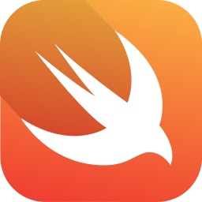
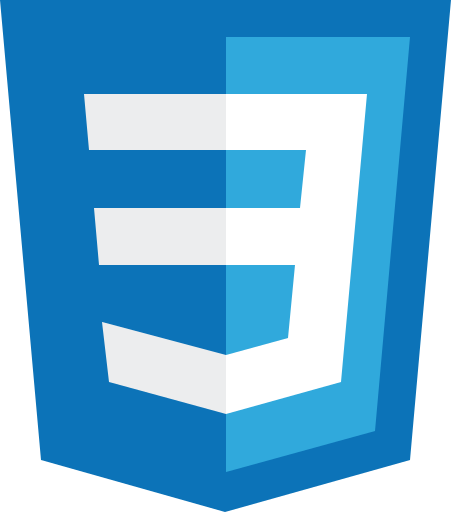
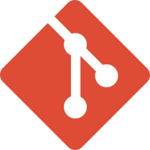

Hi there 👋 I'm Enrique Macías López
Software Engineer | Full-Stack Development & AI Applications
Computer Science graduate from Tecnológico de Monterrey, Mexico.

I'm a software engineer who enjoys building web and mobile applications from the ground up. I like working on the whole product, from the user interface to the backend, database, and deployment.

During my internship at Softtek, I was the sole developer of the Agentic Workflows module of an enterprise AI platform. I built its visual editor, workflow execution engine, LLM integrations, and deployment capabilities. The module reached production and was used internally at Softtek.

I'm currently building my own software products and looking for a full-time engineering role where I can keep learning and work with experienced developers.
👨🏻‍💻 About Me
- 🎓 Graduated in Computer Science and Technology from Tecnológico de Monterrey.
- 💼 Former Software Developer Intern at Softtek, focused on AI applications and full-stack development.
- 🔭 Building Passly, a digital loyalty platform with Apple Wallet and Google Wallet integrations.
- 🚀 Co-founder & CTO of RLVO, a university marketplace where I'm the sole developer.
- 🤖 Interested in AI agents, software architecture, and workflow automation.
- 🌱 Always learning more about building reliable software and better products.
- 💪🎾 Former varsity tennis player, gym enthusiast, and avid tennis player.
- ☕️ A caramel latte is still my favorite debugging companion.
- 🌎 Based in Monterrey, Mexico. Open to full-time opportunities, remote work, and relocation.

💻 Programming Languages:

				

TypeScript	JavaScript	Swift	HTML	CSS

📚 Frameworks & Libraries:

				

React	Next.js	Node.js	Tailwind CSS	React Native

Also working with Express, TanStack Start, Expo, and SwiftUI.

🗄️ Databases & Backend

				

PostgreSQL	Supabase	Firebase	SQL Server	Prisma

🛠️ Tools & Infrastructure

				

Git	Docker	Kubernetes	Helm	Cloudflare

Also working with Istio, GitHub, Xcode, VS Code, and Figma.

🤖 AI Applications

- LLM integrations with GPT, Claude, and Gemini.
- AI SDK, Model Context Protocol (MCP), and tool integrations.
- Visual workflow automation, execution engines, and prompt engineering.
- OCR, generative interfaces, and AI-assisted content moderation.

🚀 What I'm Building

Passly

A B2B digital loyalty platform with Apple Wallet and Google Wallet integrations. I'm the sole developer, working on multi-tenant architecture, transactional rewards, and asynchronous Wallet synchronization.

Next.js · TypeScript · Supabase · PostgreSQL
Status: Advanced MVP, validated in staging.

RLVO

A marketplace for university students. I'm a co-founder, CTO, and sole developer, responsible for the mobile app, backend, architecture, infrastructure, and technical decisions.

React Native · Expo · TypeScript · Supabase
Status: In development and staging validation.

Orqentic AI

A visual workflow automation platform I built independently, with AI agents, a modular execution engine, external integrations, and AI-assisted workflow design.

React · TanStack Start · TypeScript · Cloudflare Workers · Supabase

📂 Selected Projects

- Escalando Fronteras CMS: Bilingual full-stack CMS built for a nonprofit as a paid freelance project.
- Bufetec: Academic iOS prototype for legal appointment management, with a Gemini-powered chatbot.
- WORKSENSE: Collaborative Scrum project management platform with AI-assisted story generation and sprint analytics.
- Personal Portfolio: My software projects, experience, and technical case studies.
<h3>🤝🏻 Connect with Me</h3>

  
  
  
  

